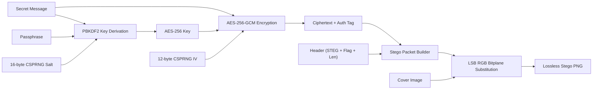
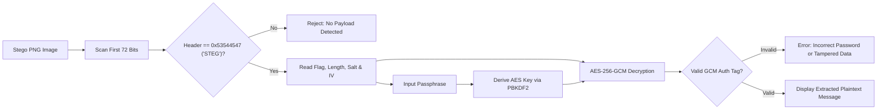

# 🛡️ StegoShield

> **Military-Grade Client-Side Image Steganography & AES-256-GCM Cryptographic Engine**  
> *Zero-server, zero-telemetry, 100% private in-browser information concealment.*

---

## 🌟 Overview

**StegoShield** is an advanced, production-grade web application combining state-of-the-art cryptography with digital image steganography. It allows users to encrypt confidential messages with **AES-256-GCM** (authenticated symmetric cipher with PBKDF2 key derivation) and embed the resulting ciphertext imperceptibly into the Least Significant Bits (LSB) of standard image carriers (PNG, JPG, WEBP).

The generated stego carrier is saved as a **lossless PNG** image that appears visually identical to the original image to both the naked eye and histogram visualizers, while securely carrying encrypted data that can only be extracted and decrypted with the authorized passphrase.

---

## ✨ Key Features

- **🔐 Dual-Layer Security**:
  - **Layer 1 (Cryptography):** AES-256-GCM encryption with 128-bit authentication tag.
  - **Layer 2 (Steganography):** LSB substitution across RGB pixel planes.
- **🛡️ 100,000 PBKDF2 Derivation Rounds**: Derives 256-bit AES encryption keys from user passphrases using HMAC-SHA256 and a 16-byte cryptographically secure random salt (CSPRNG).
- **🔏 Authenticated Integrity Verification**: Built-in Galois/Counter Mode (GCM) integrity tag verification detects any tampering, bit corruption, or incorrect decryption passwords instantly.
- **⚡ 100% Client-Side & Zero-Server**: All cryptographic and canvas operations occur entirely in the client browser using the standard W3C Web Cryptography API (`window.crypto.subtle`). No images or data are ever transmitted across the network.
- **📊 Real-Time Capacity Calculation**: Dynamically computes carrier byte capacity and provides an interactive storage utilization bar with color-coded safety thresholds.
- **🎨 Modern Dark Glassmorphic UI**: Built with pure Vanilla CSS, custom CSS properties, smooth micro-animations, toast notification feedback, and a dynamic password strength meter.
- **🚫 Zero Dependencies**: Written in pure, dependency-free Vanilla HTML5, CSS3, and ECMAScript 2022. No node modules, no external scripts, no tracking libraries.

---

## 🚀 Quick Start (Running Locally)

Because StegoShield utilizes the Web Cryptography API (`window.crypto.subtle`), modern browsers require a **Secure Context** (`http://localhost` or `https://`).

### Method 1: Python Built-in Server (Recommended)
Open a terminal in the project directory and run:

```bash
# Python 3
python -m http.server 8085
```
Then navigate to: **`http://localhost:8085`** in any modern web browser (Chrome, Edge, Firefox, Safari).

### Method 2: Node.js HTTP Server
```bash
# Using npx without installation
npx serve .
# Or using http-server
npx http-server -p 8085
```

### Method 3: Direct File Execution
You can also double-click `index.html` to open it in your browser. (Note: Most modern browsers support `crypto.subtle` in `file:///` mode; however, running via a local HTTP server is recommended for full feature compatibility).

---

## 📖 How It Works

### 1. Hiding a Secret Message (Encoding Workflow)



1. **Carrier Upload**: Select or drag & drop any image file (PNG, JPG, WEBP).
2. **Payload Entry**: Enter your secret message. The capacity gauge immediately displays storage consumption.
3. **Encryption Toggle**: Enable AES-256-GCM and enter a secure passphrase.
4. **Key Derivation**: The system generates a 16-byte random salt and derives a 256-bit key via 100,000 PBKDF2-HMAC-SHA256 iterations.
5. **Authenticated Cipher**: The message is encrypted with a unique 12-byte IV into AES-GCM ciphertext with a 128-bit authentication tag.
6. **Bit Embedding**: The binary packet is serialized and injected into the lowest bit of the Red, Green, and Blue channels of the image pixels.
7. **Export**: Download the generated lossless `.png` carrier.

---

### 2. Extracting a Hidden Message (Decoding Workflow)



1. **Upload Stego Image**: Drag & drop the carrier PNG into the Decoder tab.
2. **Passphrase Input**: Enter the decryption passphrase used during embedding.
3. **Scan & Extract**: The engine verifies the `0x53544547` (`STEG`) signature, unpacks the binary packet, executes PBKDF2 key derivation, verifies the 128-bit GCM authentication tag, and displays the authenticated message.
4. **Copy to Clipboard**: Click the copy icon to transfer the message to your clipboard.

---

## 📦 Binary Packet Protocol Specification

The embedded payload follows a structured binary packet format serialized into the RGB bitplanes:

| Byte Offset | Field Name | Size (Bytes) | Data Type | Description |
| :--- | :--- | :--- | :--- | :--- |
| `0x00 - 0x03` | **Magic Header** | 4 | `ASCII` | Fixed magic signature `0x53 0x54 0x45 0x47` (`STEG`) |
| `0x04` | **Encryption Flag** | 1 | `uint8` | `0x01` = AES-256-GCM Encrypted, `0x00` = Plaintext |
| `0x05 - 0x08` | **Payload Length** | 4 | `uint32` (BE) | Big-Endian byte length of the body payload |
| `0x09 - 0x18` | **Salt** *(if encrypted)* | 16 | `binary` | CSPRNG random salt for PBKDF2 key derivation |
| `0x19 - 0x24` | **Initialization Vector** *(if enc)* | 12 | `binary` | CSPRNG random IV for AES-GCM cipher |
| `0x25 - End` | **Payload Body** | Variable | `binary` | AES-GCM Ciphertext (with 16-byte tag) or Plaintext |

---

## 🧮 Mathematical Capacity Formula

Given a carrier image with width $W$ and height $H$ pixels, utilizing 3 color channels ($R, G, B$) with 1 bit embedded per channel:

$$\text{Capacity (Bytes)} = \left\lfloor \frac{W \times H \times 3}{8} \right\rfloor$$

### Practical Capacity Examples:
- **Small Image (400 &times; 300 px):** $45,000\text{ bytes} \approx \mathbf{43.9\text{ KB}}$ ($\approx 40,000\text{ characters}$)
- **HD Image (1280 &times; 720 px):** $345,600\text{ bytes} \approx \mathbf{337.5\text{ KB}}$
- **Full HD Image (1920 &times; 1080 px):** $777,600\text{ bytes} \approx \mathbf{759.3\text{ KB}}$ ($\approx 750\text{ pages of text}$)
- **4K Image (3840 &times; 2160 px):** $3,110,400\text{ bytes} \approx \mathbf{3.03\text{ MB}}$

---

## ⚠️ Important Security & Usage Notice

> [!WARNING]
> **Always transmit and store stego images in uncompressed, lossless formats (PNG).**  
> Messaging services and social networks (e.g. WhatsApp, Facebook, Instagram, Twitter/X, Discord) automatically recompress uploaded images with lossy **JPEG compression** to reduce bandwidth. Lossy JPEG compression uses Discrete Cosine Transform (DCT) quantization, which discards high-frequency pixel variations and **permanently wipes out the least significant bits**.
> 
> To share stego images securely, send them as **uncompressed files / documents** (e.g., as a File attachment or within a `.zip` archive).

---

## 📂 Project Structure

```text
simple-stag/
├── index.html           # Main semantic HTML5 application interface
├── style.css            # Dark glassmorphic styling, animations, responsive layout
├── app.js               # Web Crypto API & LSB steganography core engine
├── sample_carrier.png   # Bundled 400x300 sample image for instant testing
├── REQUIREMENTS.md      # Detailed Software Requirements Specification (SRS)
├── PROJECT_REPORT.md    # Comprehensive academic final year project report
├── requirements.txt     # Optional local server & test dependency references
└── README.md            # Project documentation and user guide
```

---

## 🎓 Academic Attribution & Credits

- **Domain:** Information Security, Digital Watermarking, and Cryptography
- **Standards:** NIST FIPS 197 (AES), NIST SP 800-38D (GCM Mode), NIST SP 800-132 (PBKDF2)
- **Engine:** Pure Vanilla Web Standards (HTML5 / CSS3 / ES2022)
- **License:** Open Source for educational, research, and non-commercial development.
